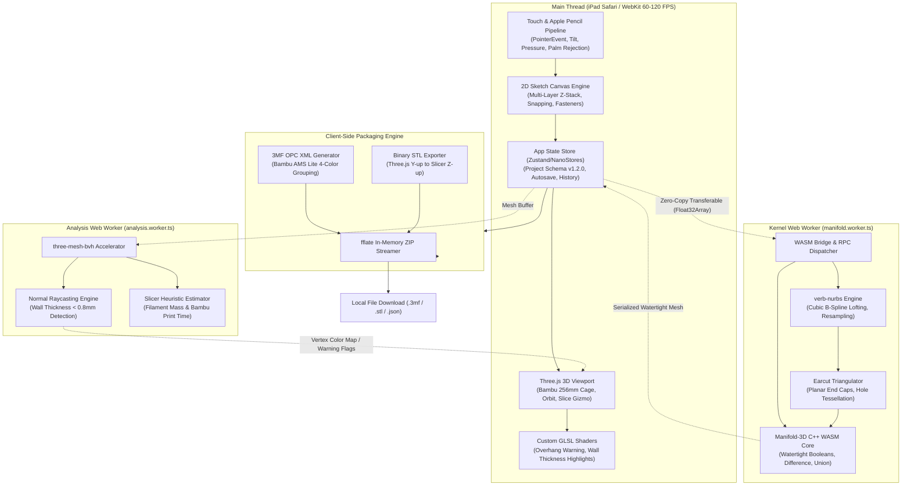
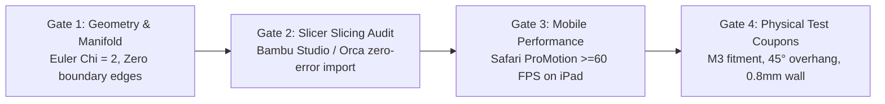

# SKETCH3D: MASTER BUILD ROADMAP & TECHNICAL SPECIFICATION
**Autonomous 3D Sketch-to-Print Web CAD for iPad & Bambu Lab A1**

*Document Version:* `2.0.0-PROD`  
*Release Target:* Phase 1 (Cubic & Mechanical) $\to$ Phase 2 (WASM Kernel & Lofting) $\to$ Phase 3 (Procedural Textures & Guardrails)  
*Hardware Target:* [Bambu Lab A1](https://bambulab.com/en/a1/tech-specs) ($256 \times 256 \times 256\text{ mm}^3$, $0.4\text{ mm}$ Nozzle, Textured PEI Bed, AMS Lite 4-Color)  
*Deployment Architecture:* 100% Client-Side WebGL / WebAssembly (Zero Backend, \$0 Cost, GitHub Pages `iocfinc.github.io/sketch3d/`)  
*Document Owners:* Swarm Architecture Team (`@kernel-lead`, `@ux-lead`, `@slicer-guardrails`, `@roadmap-compiler`)

---

## 1. Executive Summary & Product Vision

### 1.1 The Vision: "Napkin Sketch to Bambu Bed in 60 Seconds"
Traditional parametric CAD software (Rhino/Grasshopper, Fusion 360, SolidWorks) presents steep learning curves, desktop keyboard-and-mouse dependencies, and fragile multi-step export pipelines. Conversely, mobile drawing tools lack physical engineering constraints, mechanical clearances, and watertight solid modeling guarantees.

**Sketch3D** bridges this divide by delivering an **iPad-first, Apple Pencil-optimized, zero-install 3D sketch modeler** engineered specifically for the Bambu Lab A1 3D printing ecosystem:
1. **Touch & Pencil Native:** Direct 2D canvas sketching with haptic magnetic snapping, Apple Pencil pressure/tilt interaction, and two-finger tactile navigation.
2. **True Solid Modeling in WebAssembly:** Offloading constructive solid geometry (CSG), watertight boolean cuts, and loft capping to `manifold-3d` running in a dedicated background Web Worker to preserve a buttery 60–120 FPS UI on iPadOS Safari.
3. **Hardware-Locked Guardrails:** The $256 \times 256 \times 256\text{ mm}$ Bambu A1 build envelope, $0.4\text{ mm}$ nozzle wall limits ($0.8\text{ mm}$ minimum feature thickness), $45^\circ$ overhang thresholds, and PEI shrinkage compensations are embedded directly into the canvas and viewport shaders.
4. **Bambu AMS Lite Multi-Color Native:** Direct generation of multi-part, multi-material `.3MF` project archives with pre-mapped color slots matching the Sketch3D cyberpunk brand palette.
5. **Zero Backend, Zero Operational Overhead:** The complete application executes locally in the user's browser via WebGL, Web Workers, and WebAssembly, deploying effortlessly as a PWA to GitHub Pages.

---

### 1.2 Brand Design System & Color Palette
The UI adheres strictly to the cyberpunk high-contrast dark theme established in the v1 prototype:

| Token Name | Hex Code | Swatch | Application Context |
| :--- | :--- | :--- | :--- |
| **Canvas Void** | `#020203` | `⬛` | App viewport backdrop, deep contrast canvas background |
| **Brand Yellow** | `#FEFF00` | `🟨` | Primary CTA, active sketch vertex, selected layer highlight |
| **Brand Pink** | `#FF66D9` | `🌸` | Default 3D solid mesh material, secondary selection state |
| **Brand Green** | `#00E56D` | `🟩` | Bambu build plate grid, safe overhangs, export confirmation |
| **Brand Cyan** | `#73E6F1` | `🩵` | Wireframe overlay, dimension callouts, cutout loops, onion skin |
| **Warning Amber** | `#FFB800` | `🟧` | 45°–60° overhang caution, 0.8–1.2mm wall thickness caution |
| **Critical Red** | `#FF3344` | `🟥` | Sub-0.8mm non-printable geometry, >60° unprintable overhang |

---

## 2. High-Level System Architecture

### 2.1 Multi-Threaded Process & Dataflow Diagram
To prevent heavy geometry operations (CSG booleans, NURBS evaluations, polygon triangulation, and raycast wall thickness analysis) from dropping frames on mobile Safari, Sketch3D decouples UI interaction from geometry evaluation via Web Workers and Transferable ArrayBuffers.



---

### 2.2 Cross-Thread Memory & Buffer Schemas
Zero-copy serialization between the Main Thread and `manifold.worker.ts`:

```typescript
// Shared Data Transfer Structure
export interface SerializedMeshBuffer {
  // Stride 6: [posX, posY, posZ, normX, normY, normZ]
  vertexProperties: Float32Array;
  // Indexed Triangles: [v0, v1, v2, ...]
  triangleIndices: Uint32Array;
  // Multi-material segment IDs for Bambu AMS Lite slots (0-3)
  faceMaterialIDs?: Uint8Array;
}

// Web Worker RPC Message Envelope
export interface KernelRPCRequest {
  taskId: string;
  operation: 'EXTRUDE_SOLID' | 'BOOLEAN_DIFFERENCE' | 'NURBS_LOFT' | 'APPLY_TEXTURE';
  primaryGeometry: SerializedMeshBuffer;
  auxiliaryGeometries?: SerializedMeshBuffer[];
  parameters: Record<string, number | string | boolean>;
}

export interface KernelRPCResponse {
  taskId: string;
  success: boolean;
  resultMesh?: SerializedMeshBuffer;
  metrics: {
    vertexCount: number;
    triangleCount: number;
    volumeMm3: number;
    isManifold: boolean;
    computeTimeMs: number;
  };
  errorMessage?: string;
}
```

---

## 3. Phase 1 Sprint Plan: Cubic, Skeletal & Mechanical Foundations
**Sprint Duration:** 2 Weeks (Days 1–14)  
**Primary Milestone:** Deliver functional multi-layer stepped extrusion, calibrated mechanical clearances, and `.sketch3d.json` file serialization on the existing zero-build HTML5 baseline.

### 3.1 Objectives & Deliverables
1. **Multi-Layer Z-Stack UX:** Enable creation and management of independent 2D sketch planes positioned at discrete Z heights ($0 \le Z \le 256\text{ mm}$).
2. **Onion-Skin Visual Alignment:** Render ghosted outlines of adjacent layers with magnetic snapping between layers for perfect concentric fastener holes.
3. **Mechanical Tolerance Presets:** Instant placement of M2.5, M3, M4, and M5 fastener clearance holes ($+0.20\text{ mm}$ standard, heat-set insert tapers).
4. **Project Serialization (`.sketch3d.json`):** Full state save/load, drag-and-drop file import, automatic migration from v1.0.0 sketches, and debounced local autosave.
5. **Bambu Bed & Slicer Foundations:** Textured PEI elephant's foot compensation (automatic $0.6\text{ mm} \times 45^\circ$ base chamfer), material density calculations (PLA, PETG, ABS, TPU), and 2D wall proximity warnings.

### 3.2 Sprint 1 Work Breakdown Schedule

```mermaid
gantt
    title Phase 1 Sprint Schedule (Days 1 to 14)
    dateFormat  X
    axisFormat Day %d
    
    section Multi-Layer Architecture
    Z-Stack State Model & UI Drawer          :active, d1, 0, 3
    3D Viewport Synchronized Slice Gizmo      :d2, 3, 5
    Onion-Skin 2D Rendering Engine            :d3, 4, 7
    
    section Mechanical Presets
    Fastener Clearance Selector (M2.5-M5)     :d4, 2, 5
    Snap-Fit Cantilever Generator Math        :d5, 5, 8
    Elephant's Foot PEI Chamfer Offset        :d6, 7, 9
    
    section Serialization & Guardrails
    Schema v1.2.0 JSON Import/Export          :d7, 5, 9
    Drag-and-Drop + Autosave Engine           :d8, 8, 11
    2D Polygon Proximity Thickness Check      :d9, 9, 12
    Sprint 1 Integration & E2E Validation     :d10, 12, 14
```


---

## 4. Phase 2 Sprint Plan: WASM Manifold-3D Kernel, NURBS Lofting, 3MF & PWA
**Sprint Duration:** 3 Weeks (Days 15–35)  
**Primary Milestone:** Graduate from 2.5D planar extrusions to organic, multi-section NURBS lofting backed by a C++ WASM CSG kernel running in a Web Worker, full Bambu AMS Lite `.3MF` multi-color export, and modern Vite + TypeScript PWA deployment.

### 4.1 Objectives & Deliverables
1. **Vite + TypeScript Migration:** Refactor the single-file codebase into a clean, modular TypeScript architecture supporting worker bundling and WASM loaders.
2. **`manifold-3d` WASM Worker Integration:** Embed the Manifold-3D Emscripten C++ kernel inside a dedicated Web Worker using zero-copy Transferable ArrayBuffers.
3. **Multi-Section NURBS Lofting Engine:** Implement `verb-nurbs` surface interpolation between $K \ge 2$ sketch sections with uniform arc-length chord resampling, anti-twist phase shift optimization, and watertight planar Earcut end-caps.
4. **Bambu AMS Lite Multi-Color .3MF Exporter:** Transition from flat STL to OPC `.3MF` ZIP containers using `fflate`, embedding Bambu Studio configuration profiles and multi-material color slots matching the Sketch3D brand palette.
5. **PWA Safari Packaging:** Complete `manifest.json`, Service Worker cache-first strategy for zero-latency offline usage on iPadOS, and GitHub Actions CD deploying to `iocfinc.github.io/sketch3d/`.

### 4.2 Sprint 2 Work Breakdown Schedule

```mermaid
gantt
    title Phase 2 Sprint Schedule (Days 15 to 35)
    dateFormat  X
    axisFormat Day %d

    section Modern Stack & Workers
    Vite + TypeScript Modular Restructure     :active, d11, 15, 19
    manifold-3d Web Worker Bridge Setup       :d12, 18, 23
    PWA Service Worker & Manifest             :d13, 21, 25

    section Advanced Geometry
    verb-nurbs Arc-Length Resampling Engine   :d14, 22, 27
    Anti-Twist Phase Alignment Algorithm      :d15, 26, 30
    Watertight Earcut End-Cap Synthesis       :d16, 28, 32

    section Slicer Export Pipeline
    3MF OPC XML Document Structuring          :d17, 27, 31
    fflate In-Memory ZIP Packaging Engine     :d18, 30, 33
    Bambu AMS Lite 4-Color Slot Integration   :d19, 32, 35
```


---

## 5. Phase 3 Sprint Plan: Procedural Textures, Voronoi Lattices & Slicer Guardrails
**Sprint Duration:** 3 Weeks (Days 36–56)  
**Primary Milestone:** Implement physical 3D printable surface textures (diamond knurling, conformal Voronoi weight-reduction lattices), real-time Three.js overhang warning shaders, and Bambu A1 print time and filament heuristic engines.

### 5.1 Objectives & Deliverables
1. **Procedural Normal Displacement Engine:** Parametric vertex displacement along calculated surface normals $S(u, v)$ with clamped amplitude ($A \le 1.2\text{ mm}$) and nozzle-friendly spatial wavelengths ($\lambda \ge 2.5\text{ mm}$).
2. **Conformal Voronoi Weight-Reduction Lattices:** Conformal 2D/3D Voronoi cell generation projected onto curved NURBS shells with metric tensor distortion correction, automatic minimum wall clearance ($w \ge 1.2\text{ mm}$), and CSG difference punching.
3. **Three.js Custom Overhang Warning Shader:** Real-time GLSL fragment shader highlighting upward faces (safe green), 45°–60° overhangs (yellow warning), >60° steep overhangs (red critical), and horizontal bridge ceilings.
4. **Mesh-BVH Inward Raycasting Wall Thickness Validator:** Background worker raycasting inward normals against a BVH tree, tagging vertices below $0.80\text{ mm}$ critical nozzle limit.
5. **Bambu Lab A1 Print Estimator:** Accurate print time and mass computation incorporating printer startup calibrations ($360\text{ s}$), volumetric flow ceilings ($12\text{ mm}^3/\text{s}$ PLA), layer changes ($1.8\text{ s}$), and infill/shell densities.

### 5.2 Sprint 3 Work Breakdown Schedule

```mermaid
gantt
    title Phase 3 Sprint Schedule (Days 36 to 56)
    dateFormat  X
    axisFormat Day %d

    section Surface Synthesis
    Surface Normal & Tangent Math Evaluator   :active, d20, 36, 40
    Diamond Knurling & Ribbed Fin Math        :d21, 39, 44
    Conformal Voronoi Shell Puncher           :d22, 43, 49

    section Hardware Guardrails
    Custom GLSL Overhang Angle Shader         :d23, 41, 46
    three-mesh-bvh Wall Thickness Raycaster   :d24, 45, 51
    Bambu A1 Print Time & Mass Estimator      :d25, 48, 54
    Hardened E2E Test on Bambu Studio / Orca :d26, 52, 56
```


---

## 6. Detailed Implementation Ticket Breakdown

### EPIC-1: Multi-Layer Z-Stacking & Sketch Plane Orchestration
**Theme:** Transition from single 2.5D extrusion to multi-height 3D assemblies.

#### TICKET-101: Vertical Z-Stack Layer Drawer & State Architecture
- **Epic:** EPIC-1
- **User Story:** As an iPad CAD user, I want a slide-out vertical Z-stack drawer showing my sketch planes ordered by height, so that I can independently create, select, and adjust elevations across the $0–256\text{ mm}$ build envelope.
- **Technical Specification:**
  - Implement `LayersManager` with reactive state tracking `layers: LayerState[]`.
  - Drawer UI docked to viewport edge with graduated vertical millimeter ruler ($0–256\text{ mm}$).
  - Layer chips showing layer label, elevation badge (`Z: 12.0 mm`), micro-steppers (`+`/`-` in $0.5\text{ mm}$ steps), and visibility/lock toggles.
  - Reordering via drag handle updates elevation order with automatic collision prevention.
- **Acceptance Criteria:**
  - [ ] Supports between 1 and 8 independent sketch planes.
  - [ ] Dragging layer chip dynamically updates its Z elevation in the 3D scene.
  - [ ] Tapping a layer switches the 2D sketch canvas context to that plane within 16ms.
  - [ ] Clamp Z between $0.0\text{ mm}$ and $256.0\text{ mm}$.
- **Tech Stack:** TypeScript, HTML5 Touch Events, Tailwind CSS.

#### TICKET-102: Viewport Slice Gizmo & Bi-Directional Plane Synchronization
- **Epic:** EPIC-1
- **User Story:** As a 3D designer, I want an interactive visual cutting plane in the 3D viewport, so that I can see exactly where my active sketch plane cuts through the model.
- **Technical Specification:**
  - Create Three.js `SliceGizmo` consisting of a translucent cyan quad ($256 \times 256\text{ mm}$) and vertical 3D translation arrow.
  - Synchronize gizmo position with the selected layer's `zElevation`.
  - Double-tapping any 3D geometry section raycasts to the nearest layer and opens it in the 2D canvas.
- **Acceptance Criteria:**
  - [ ] Slice gizmo renders at correct world Z coordinate.
  - [ ] Interactive dragging in 3D updates 2D canvas elevation badge in real time.
  - [ ] Gizmo auto-hides during auto-spin or export mode.
- **Tech Stack:** Three.js (`THREE.PlaneGeometry`, `THREE.Raycaster`), PointerEvents.

#### TICKET-103: Multi-Layer 2D Onion Skinning & Concentric Alignment
- **Epic:** EPIC-1
- **User Story:** As an engineer designing multi-plate enclosures, I want to see faint ghosted outlines of the layers above and below my active layer, so that I can align bolt holes perfectly between parts.
- **Technical Specification:**
  - In 2D sketch render loop, render Layer $N-1$ in dashed `#73E6F1` (alpha 0.35) and Layer $N+1$ in dashed `#FF66D9` (alpha 0.35).
  - Feed ghosted vertices and hole centers into `SnappingEngine` as Tier-2 snap targets.
  - Display concentric snap glyph ($\odot$) and fire haptic tick (`navigator.vibrate([10])`) when locked.
- **Acceptance Criteria:**
  - [ ] Ghost outlines render under the active sketch layer without obscuring active vertices.
  - [ ] Dropping an M3 hole within $24\text{px}$ of an underlying hole snaps concentrically with $0.00\text{ mm}$ offset.
  - [ ] Toggle button in header allows disabling onion skinning for visual clarity.
- **Tech Stack:** HTML5 2D Canvas API, Navigator Haptics API.

---

### EPIC-2: Mechanical Tolerances, Fasteners & Calibrated Parametric Joints
**Theme:** Precision engineering primitives calibrated specifically for Bambu Lab A1 0.4mm nozzle FDM characteristics.

#### TICKET-201: Mechanical Fastener Clearance Hole Selector
- **Epic:** EPIC-2
- **User Story:** As a maker assembling 3D prints with metric hardware, I want pre-calibrated hole presets for M2.5, M3, M4, and M5 bolts, so that my printed holes fit bolts without drilling.
- **Technical Specification:**
  - Provide UI modal/dropdown for hole placement modes:
    - **Close Fit (+0.20mm):** M2.5 ($\varnothing 2.7\text{mm}$), M3 ($\varnothing 3.2\text{mm}$), M4 ($\varnothing 4.2\text{mm}$), M5 ($\varnothing 5.2\text{mm}$).
    - **Free Fit (+0.40mm):** M2.5 ($\varnothing 2.9\text{mm}$), M3 ($\varnothing 3.4\text{mm}$), M4 ($\varnothing 4.5\text{mm}$), M5 ($\varnothing 5.5\text{mm}$).
    - **Heat-Set Insert (Tapered):** M3 ($\varnothing 4.0\text{mm}$ top $\to \varnothing 3.85\text{mm}$ bottom).
    - **SHCS Counterbore:** M3 pocket ($\varnothing 5.9\text{mm} \times 3.3\text{mm}$ depth).
  - Tap-to-place on 2D canvas with automatic minimum edge distance enforcement ($d_{\text{edge}} \ge 1.2\text{ mm}$).
- **Acceptance Criteria:**
  - [ ] Default M3 hole diameter outputs exactly $3.20\text{ mm}$ in exported STL/3MF.
  - [ ] Holes placed too close to perimeter (<0.8mm) trigger visible warning badge.
  - [ ] Counterbore depth clamped to not exceed layer thickness.
- **Tech Stack:** 2D Canvas Geometry, Fastener Preset Database.

#### TICKET-202: Parametric Cantilever Snap-Fit Joint Generator
- **Epic:** EPIC-2
- **User Story:** As an enclosure designer, I want a 1-click snap-fit clip generator, so that I can print snap-together cases without screws or glue.
- **Technical Specification:**
  - Implement cantilever beam calculation: $y = \frac{\epsilon \cdot L^2}{1.5 \cdot t}$ (PLA allowable strain $\epsilon=1.5\%$, PETG $\epsilon=2.5\%$).
  - Generate profile with $30^\circ$ lead-in insertion angle, $85^\circ$ retention latch, $0.35\text{ mm}$ mating clearance gap, and $0.8\text{ mm}$ root fillet to eliminate shear stress concentration.
  - Insert paired tab and mating socket directly into selected polygon edge.
- **Acceptance Criteria:**
  - [ ] Snap-fit arm passes deflection test without exceeding material yield limit.
  - [ ] Root fillet correctly generated with $R \ge 0.8\text{ mm}$.
  - [ ] Sockets incorporate $0.35\text{ mm}$ Bambu A1 tolerance offset.
- **Tech Stack:** Analytical Beam Mechanics, Polygon Boolean Offsets.

#### TICKET-203: Bambu PEI Plate Elephant's Foot Compensator
- **Epic:** EPIC-2
- **User Story:** As a 3D printer operator, I want automatic first-layer elephant's foot compensation, so that bottom edges don't bulge outward and ruin fitment.
- **Technical Specification:**
  - On layer 0 ($Z = 0$), detect bottom perimeter.
  - Implement dual mitigation options:
    - **Option A (Chamfer):** Apply $45^\circ \times 0.6\text{ mm}$ bottom chamfer during extrusion.
    - **Option B (Contour Offset):** Inset first layer contour by $-0.15\text{ mm}$ relative to subsequent layers.
- **Acceptance Criteria:**
  - [ ] Exported mesh shows clean $0.6\text{ mm}$ bottom relief chamfer.
  - [ ] Verified flush fitment when two printed parts are joined bottom-to-bottom.
- **Tech Stack:** Three.js ExtrudeGeometry Custom Bevel, Polygon Insetting.

---

### EPIC-3: Project Serialization, Schema Validation & State Persistence
**Theme:** Robust document saving, restoring, and migration.

#### TICKET-301: Project JSON Schema v1.2.0 & Validation Engine
- **Epic:** EPIC-3
- **User Story:** As a user, I want to save my work to a standardized `.sketch3d.json` file and reload it without losing layers, modifiers, or hardware bounds.
- **Technical Specification:**
  - Define JSON schema v1.2.0 containing `metadata`, `hardwareBounds`, `globalModifiers`, `layers[]`, and `viewportState`.
  - Build migration router supporting legacy v1.0.0 flat schemas (auto-mapping single polygon to `layers[0]`).
  - Strict schema validation with schema error reporting on invalid files.
- **Acceptance Criteria:**
  - [ ] Complete project serializes to single `.sketch3d.json` file under 250 KB.
  - [ ] Legacy v1.0.0 files load seamlessly into new multi-layer architecture.
  - [ ] Export filenames formatted: `sketch3d_[project-title]_[timestamp].sketch3d.json`.
- **Tech Stack:** JSON Schema, TypeScript Interfaces.

#### TICKET-302: Drag-and-Drop Restoration & Local Autosave
- **Epic:** EPIC-3
- **User Story:** As an iPad or desktop user, I want to drag a `.sketch3d.json` file directly onto the browser window and have my project restored instantly.
- **Technical Specification:**
  - Global `dragover` / `drop` event listeners with visual dropzone overlay.
  - FileReader stream loading with JSON validation.
  - Debounced (1500ms) background autosave to `localStorage['sketch3d_autosave_v1']`.
  - Startup check displaying "Restore unsaved project" banner if an unpersisted session is found.
- **Acceptance Criteria:**
  - [ ] Dropping file anywhere on window opens project without page reload.
  - [ ] Accidental page refresh restores complete sketch and camera position.
  - [ ] Corrupted local storage gracefully fails with toast alert.
- **Tech Stack:** Web Storage API, HTML5 Drag and Drop API.

---

### EPIC-4: Modern Web Core (Vite, TypeScript & PWA Safari Offline Stack)
**Theme:** Transition from single-file HTML to production modular PWA.

#### TICKET-401: Vite + TypeScript Modular Refactoring
- **Epic:** EPIC-4
- **User Story:** As a developer, I want a modular TypeScript directory structure, so that web workers, WASM binaries, and UI components can be developed cleanly with tree-shaking.
- **Technical Specification:**
  - Initialize Vite with `@vitejs/plugin-legacy` and `vite-plugin-wasm`.
  - Directory structure:
    - `src/canvas2d/` (Canvas engines, snapping, layers, presets)
    - `src/viewport3d/` (Three.js scenes, envelopes, gizmos, shaders)
    - `src/workers/` (Kernel RPC bridges, manifold worker, analysis worker)
    - `src/app/` (State store, pointer dispatchers, touch handlers)
  - Configure `base: './'` for instant deployment to GitHub Pages (`iocfinc.github.io/sketch3d/`).
- **Acceptance Criteria:**
  - [ ] Production build compiles without TypeScript errors (`tsc --noEmit`).
  - [ ] Total initial JS bundle under 180 KB gzipped (excluding WASM).
  - [ ] Runs identically locally (`localhost:5173`) and on GitHub Pages subpaths.
- **Tech Stack:** Vite 5, TypeScript 5.3, Tailwind CSS.

#### TICKET-402: iPad Safari PWA Offline Packaging & Service Worker
- **Epic:** EPIC-4
- **User Story:** As an iPad user, I want to add Sketch3D to my home screen and use it on an airplane with zero internet connection.
- **Technical Specification:**
  - Create `manifest.json` with `display: standalone`, `theme_color: #020203`, and 192px/512px maskable icons.
  - Configure iOS WebKit meta tags: `apple-mobile-web-app-capable`, `black-translucent` status bar.
  - Implement Service Worker (`sw.js`): Cache-First strategy for Three.js, fonts, and `manifold.wasm`; Network-First for dynamic presets.
  - CSS safe-area-inset padding for iPhone Dynamic Island and iPad home indicator.
- **Acceptance Criteria:**
  - [ ] App launches full-screen without Safari browser chrome when tapped from home screen.
  - [ ] Complete app functions offline in Airplane Mode with full 3D rendering and STL/3MF export.
  - [ ] Passes Google Lighthouse PWA audit with 100/100 score.
- **Tech Stack:** Progressive Web App (PWA), Service Worker API, Cache API.

---

### EPIC-5: High-Performance Geometry Kernel (WASM Manifold-3D in Web Worker)
**Theme:** Guaranteed watertight boolean operations without UI thread stalls.

#### TICKET-501: Manifold-3D WASM Integration & Web Worker RPC
- **Epic:** EPIC-5
- **User Story:** As an iPad user, I want boolean cuts and cutouts to compute in the background without freezing the 120Hz ProMotion touch sketching experience.
- **Technical Specification:**
  - Spin up dedicated Web Worker `manifold.worker.ts`.
  - Load `manifold-3d` Emscripten WASM module dynamically (`./wasm/manifold.wasm`).
  - Implement RPC protocol over `postMessage` using Transferable ArrayBuffers (`Float32Array` positions/normals, `Uint32Array` indices).
  - Implement memory safety lifecycle: explicitly call `.delete()` on all intermediate C++ Manifold solids to prevent WebKit memory leaks.
- **Acceptance Criteria:**
  - [ ] Main UI thread maintains 60+ FPS while computing difference of 20 mounting holes.
  - [ ] Zero memory growth over 100 consecutive CSG operations.
  - [ ] Automatic fallback to CPU Three.js ExtrudeGeometry if WASM fails to initialize.
- **Tech Stack:** `manifold-3d` WASM, Web Workers, Transferable Objects.

#### TICKET-502: Watertight Boolean Mesh Construction Pipeline
- **Epic:** EPIC-5
- **User Story:** As a 3D printing enthusiast, I want all exported meshes to be strictly watertight solids with zero self-intersections or non-manifold edges, so that Bambu Studio never reports slicing errors.
- **Technical Specification:**
  - Pass primary extruded body and hole/cutout cylinders to `manifold.worker.ts`.
  - Perform `Manifold.difference()` or `Manifold.union()`.
  - Verify Euler characteristic $\chi = V - E + F = 2(1 - g) = 2$ for genus-0 solids, or $2(1 - N_{\text{holes}})$ for punctured plates.
  - Extract serialized manifold mesh and unpack into `THREE.BufferGeometry`.
- **Acceptance Criteria:**
  - [ ] Resulting mesh contains zero open edges (all boundary edges shared by exactly 2 faces).
  - [ ] Bambu Studio / OrcaSlicer imports mesh without "Auto-Repair" warning prompts.
  - [ ] Output includes accurate calculated solid volume in $\text{mm}^3$.
- **Tech Stack:** `manifold-3d`, Three.js `BufferGeometry`.

---

### EPIC-6: Organic Multi-Section NURBS Lofting Engine
**Theme:** Fluid mathematical transitions between stacked sketch profiles.

#### TICKET-601: Uniform Arc-Length Polygon Resampling
- **Epic:** EPIC-6
- **User Story:** As a user lofting between a 4-point square and an 8-point star, I want the system to automatically resample points, so that the loft surface doesn't twist or wrinkle.
- **Technical Specification:**
  - For each sketch curve $C_k$, compute cumulative chord lengths $s_i = \sum \|P_j - P_{j-1}\|$.
  - Resample curve into $N = 128$ uniformly spaced points along arc length $u \in [0, 1]$.
  - Handle sharp corners vs smooth tangents using curvature analysis.
- **Acceptance Criteria:**
  - [ ] All cross-sections in a loft produce exactly $N = 128$ synchronized coordinates.
  - [ ] Point density distributes proportionally to edge length rather than vertex index count.
- **Tech Stack:** B-Spline Mathematics, TypeScript.

#### TICKET-602: Anti-Twist Phase Alignment Algorithm
- **Epic:** EPIC-6
- **User Story:** As a designer, I want lofted shapes to transition smoothly without unwanted corkscrewing between layers.
- **Technical Specification:**
  - Compute circular shift offset $m^*$ between adjacent cross-sections $C_{k-1}$ and $C_k$ minimizing Euclidean distance sum:
    $$\min_{0 \le m < N} \sum_{i=0}^{N-1} \|C_k(u_{(i+m) \pmod N}) - C_{k-1}(u_i)\|^2$$
  - Re-index control points of $C_k$ by offset $m^*$.
  - Allow manual user phase override via a rotary "Twist Align" slider ($0^\circ–360^\circ$).
- **Acceptance Criteria:**
  - [ ] Lofting a square to an identical rotated square automatically aligns nearest corners.
  - [ ] Eliminates surface self-intersections caused by index misalignment.
- **Tech Stack:** Numerical Optimization, Vector Math.

#### TICKET-603: B-Spline Surface Interpolation & Watertight End-Caps
- **Epic:** EPIC-6
- **User Story:** As a creator, I want lofted cross-sections to generate a fully enclosed solid body with flat top and bottom caps.
- **Technical Specification:**
  - Evaluate cubic B-spline surface using `verb-nurbs` (`verb.geom.NurbsSurface.byLofting`).
  - Triangulate bottom cap ($v=0$) with reversed normals and top cap ($v=1$) using `earcut`.
  - Weld cap perimeter vertices to loft mantle boundary using spatial hashing.
  - Transfer watertight composite to `manifold-3d` to certify 2-manifold status.
- **Acceptance Criteria:**
  - [ ] Smooth $C^2$ continuity along the lofted height.
  - [ ] Top and bottom planar caps sealed with zero gap edges.
  - [ ] Handles non-convex and hollow annular profiles.
- **Tech Stack:** `verb-nurbs`, `earcut`, `manifold-3d`.

---

### EPIC-7: Bambu AMS Lite 4-Color .3MF Export Pipeline
**Theme:** Multi-material 3MF project packaging matching Bambu Studio specifications.

#### TICKET-701: OPC XML Document Generator for 3MF
- **Epic:** EPIC-7
- **User Story:** As a Bambu A1 owner with AMS Lite, I want to export `.3MF` files that preserve millimeter units and mesh manifolds, so that I don't have to use obsolete STL files.
- **Technical Specification:**
  - Generate Open Packaging Convention (OPC) XML file structures:
    - `[Content_Types].xml`
    - `_rels/.rels`
    - `3D/3dmodel.model`
    - `Metadata/model_settings.config` (Bambu Studio specific project parameters)
  - Enforce Z-up coordinate system: map Three.js Y-up $(x, y, z) \to 3\text{MF } (x, -z, y)$.
- **Acceptance Criteria:**
  - [ ] 3MF structure strictly complies with 3MF Core Specification v1.2.
  - [ ] Opens directly in Bambu Studio, OrcaSlicer, and PrusaSlicer with correct scale and orientation.
- **Tech Stack:** XML Serialization, 3MF Consortium Core Spec.

#### TICKET-702: Bambu AMS Lite 4-Color Grouping Specification
- **Epic:** EPIC-7
- **User Story:** As a user printing multi-color models, I want my cutouts, text, and main body to assign automatically to AMS Lite slots 1 through 4, so that I can print multi-color designs instantly.
- **Technical Specification:**
  - Define `<m:colorgroup id="1">` containing Sketch3D brand colors:
    - Slot 1: `#FEFF00` (Brand Yellow / Main Body)
    - Slot 2: `#FF66D9` (Brand Pink / Fasteners & Bosses)
    - Slot 3: `#73E6F1` (Brand Cyan / Cutouts & Accent Inlays)
    - Slot 4: `#00E56D` (Brand Green / Base Plate & Support Interfaces)
  - Map mesh triangle face indices to color groups using `pid="1"` and `p1="[0-3]"`.
- **Acceptance Criteria:**
  - [ ] Bambu Studio recognizes all 4 filament slots upon opening the `.3mf`.
  - [ ] Cutout accents and base bodies render with independent material toolpaths.
- **Tech Stack:** 3MF Materials and Properties Extension.

#### TICKET-703: In-Memory High-Speed ZIP Compression (`fflate`)
- **Epic:** EPIC-7
- **User Story:** As an iPad Safari user, I want `.3MF` files to compile in memory in under 500ms without crashing the browser.
- **Technical Specification:**
  - Integrate `fflate` for synchronous in-memory Deflate compression.
  - Package XML files and binary mesh streams into a single `Uint8Array`.
  - Trigger download via `URL.createObjectURL(new Blob([buffer], { type: 'application/vnd.ms-package.3dmanufacturing-3dmodel+xml' }))`.
  - Revoke object URL after trigger to prevent memory leaks.
- **Acceptance Criteria:**
  - [ ] Compiles a 100,000-triangle 3MF model in under $400\text{ ms}$ on iPad Pro M2.
  - [ ] Package footprint is 60–80% smaller than equivalent ASCII/binary STL.
- **Tech Stack:** `fflate`, Web Blob API.

---

### EPIC-8: Procedural Surface Textures & Conformal Lattice Synthesis
**Theme:** Real physical 3D printable surface geometry for grips, lamps, and cyberdecks.

#### TICKET-801: Normal Vector & Tangent Space Evaluator
- **Epic:** EPIC-8
- **User Story:** As an algorithm developer, I want a robust tangent space evaluator across parametric surfaces, so that procedural textures displace cleanly along true surface normals.
- **Technical Specification:**
  - For surface $S(u, v)$, compute partial derivatives $\mathbf{T}_u = \partial S / \partial u$ and $\mathbf{T}_v = \partial S / \partial v$.
  - Compute unit normal vector $\mathbf{n}(u, v) = \frac{\mathbf{T}_u \times \mathbf{T}_v}{\|\mathbf{T}_u \times \mathbf{T}_v\|}$.
  - Subdivide base mesh to target edge length $\le 0.5\text{ mm}$ ensuring adequate tessellation density for displacement.
- **Acceptance Criteria:**
  - [ ] Normal vectors evaluate smoothly across seams without normal flipping.
  - [ ] Handles closed periodic cylinders and multi-lofted surfaces.
- **Tech Stack:** Differential Geometry, Three.js Geometry.

#### TICKET-802: Diamond Knurling & Ribbed Fin Generators
- **Epic:** EPIC-8
- **User Story:** As an EDC creator, I want to apply a diamond knurled grip texture to my cardholders and dials, so that they have tactile physical grip when 3D printed.
- **Technical Specification:**
  - Diamond knurling equation:
    $$d_{\text{diamond}}(u, v) = A \cdot \left| \sin\left(\frac{2\pi u}{\lambda_u} + \frac{2\pi v}{\lambda_v}\right) \cdot \sin\left(\frac{2\pi u}{\lambda_u} - \frac{2\pi v}{\lambda_v}\right) \right|$$
  - Ribbed fin equation:
    $$d_{\text{rib}}(u, v) = \frac{A}{2} \cdot \left(1 + \cos\left(\frac{2\pi u}{\lambda_u}\right)\right)$$
  - Enforce physical printing limits: clamp amplitude $A \le 1.2\text{ mm}$, clamp wavelength $\lambda \ge 2.5\text{ mm}$ (guarantees clean 0.4mm nozzle deposition).
- **Acceptance Criteria:**
  - [ ] Vertices displace along true normal vector: $\mathbf{P}' = \mathbf{P} + d \cdot \mathbf{n}$.
  - [ ] No self-intersecting or folded triangles created at peaks and valleys.
  - [ ] Seamless wrapping around cylindrical geometries ($u=0$ matches $u=1$).
- **Tech Stack:** Procedural Mathematics, Web Workers.

#### TICKET-803: Conformal Voronoi Weight-Reduction Lattice
- **Epic:** EPIC-8
- **User Story:** As a designer creating organic lampshades or skeletonized frames, I want to convert solid shells into breathable Voronoi lattices, so that I save filament and print weight.
- **Technical Specification:**
  - Sample Poisson-disk distributed seeds across $(u, v)$ parameter space.
  - Compute conformal Voronoi diagram accounting for metric tensor $g_{ij} = \mathbf{T}_i \cdot \mathbf{T}_j$ (prevents distortion on tapered surfaces).
  - Inset cell boundaries by wall clearance $w \ge 1.2\text{ mm}$.
  - Pass cutting prisms to `manifold.worker.ts` and punch cutouts through the shell solid.
- **Acceptance Criteria:**
  - [ ] Minimum strut thickness guaranteed $\ge 1.20\text{ mm}$ across the entire lattice.
  - [ ] Results in a single unified watertight manifold solid.
  - [ ] Reduces overall model volume/mass by 30% to 60%.
- **Tech Stack:** Voronoi Tessellation, `manifold-3d` CSG Difference.

---

### EPIC-9: Real-Time Printability Guardrails & Slicer Validation Shaders
**Theme:** Active in-viewport warnings preventing failed prints before sending to Bambu A1.

#### TICKET-901: Custom GLSL Overhang Warning Shader
- **Epic:** EPIC-9
- **User Story:** As a user inspecting my 3D model, I want steep overhangs highlighted in yellow and red, so that I know where the Bambu A1 will require supports.
- **Technical Specification:**
  - Implement custom Three.js shader material evaluating world normal $n_y$ against build vector $(0, 1, 0)$:
    - $n_y \ge 0$: Upward facing (Safe Green `#00E56D`).
    - $-n_y \le \cos(45^\circ) \approx 0.7071$: Supported overhang $\le 45^\circ$ (Safe Green).
    - $0.7071 < -n_y \le \cos(60^\circ) = 0.5000$: Overhang $45^\circ–60^\circ$ (Warning Amber `#FFB800`).
    - $-n_y < 0.5000$: Steep overhang $>60^\circ$ (Critical Red `#FF3344`).
    - $-n_y \approx 0.0$ ($n_y \to -1.0$): True bridge ceiling (Crimson `#990000`).
  - Add viewport toggle button to switch between Brand Pink material and Overhang Inspection mode.
- **Acceptance Criteria:**
  - [ ] Shader executes in real-time at 120 FPS on iPad Pro.
  - [ ] Accurately delineates $45^\circ$ boundary verified against calibration cone test coupon.
  - [ ] Includes subtle directional rim lighting for geometric depth perception.
- **Tech Stack:** WebGL 2.0, Three.js Custom ShaderMaterial, GLSL.

#### TICKET-902: 3D Mesh Inward Raycast Wall Thickness Checker
- **Epic:** EPIC-9
- **User Story:** As a user sculpting complex geometry, I want thin walls under $0.8\text{ mm}$ flagged automatically, so that my print doesn't fail due to nozzle under-extrusion.
- **Technical Specification:**
  - Build spatial acceleration index using `three-mesh-bvh` in a background worker.
  - Cast rays from sample vertices inward along $-\mathbf{n}_k + \epsilon$.
  - Record hit distance $t_{\text{hit}}$.
  - If $t_{\text{hit}} < 0.80\text{ mm}$, color vertex critical magenta/red in inspection attribute buffer.
  - Display non-blocking HUD chip: `⚠️ 3 Thin Wall Warnings (< 0.8mm)`.
- **Acceptance Criteria:**
  - [ ] Detects knife-edge taper and thin extrusion walls under $0.80\text{ mm}$.
  - [ ] Raycast check completes in $<250\text{ ms}$ on 20,000-triangle mesh.
  - [ ] Clicking the warning badge pans the 3D camera directly to the defective feature.
- **Tech Stack:** `three-mesh-bvh`, Web Workers, Vertex Attributes.

---

### EPIC-10: Bambu Lab Slicer Alignment, Filament Mass & Print Time Heuristics
**Theme:** Precise filament cost and print duration feedback inside the modeling view.

#### TICKET-101: Bambu Lab Material Density & Filament Mass Engine
- **Epic:** EPIC-10
- **User Story:** As a maker budgeting filament, I want accurate material weight calculation based on whether I'm printing in PLA, PETG, ABS, or TPU.
- **Technical Specification:**
  - Compute internal decomposed volume:
    $$V_{\text{extruded}} = V_{\text{shell}} + V_{\text{caps}} + V_{\text{infill}}$$
  - Slicer profile parameters (0.2mm Standard):
    - Wall loops: 2 perimeters ($w_{\text{loop}} = 0.84\text{ mm}$).
    - Top/Bottom solid layers: 4 layers ($h_{\text{cap}} = 0.80\text{ mm}$).
    - Default sparse infill: 15% grid/rectilinear ($\eta = 0.15$).
  - Calculate mass using verified filament densities:
    - Bambu PLA Basic: $\rho = 1.24\text{ g/cm}^3$
    - Bambu PETG Basic: $\rho = 1.27\text{ g/cm}^3$
    - Bambu ABS: $\rho = 1.05\text{ g/cm}^3$
    - Bambu TPU 95A: $\rho = 1.20\text{ g/cm}^3$
- **Acceptance Criteria:**
  - [ ] Weight prediction deviates by $< 5\%$ compared to sliced output in Bambu Studio.
  - [ ] Material dropdown selector updates weight and material cost readouts instantly.
- **Tech Stack:** Analytical Slicer Heuristics, TypeScript.

#### TICKET-102: Bambu Lab A1 Kinematic Print Time Estimator
- **Epic:** EPIC-10
- **User Story:** As a creator planning prints, I want to know if my model takes 20 minutes or 4 hours to print before I export it.
- **Technical Specification:**
  - Model Bambu A1 kinematic phases:
    1. Startup & calibration overhead: $T_{\text{startup}} = 360\text{ s}$ (bed leveling, resonance sweep, nozzle purge, wipe).
    2. Volumetric extrusion time: $T_{\text{extrude}} = V_{\text{extruded}} / \dot{V}_{\text{effective}}$ ($\dot{V}_{\text{effective}} = 12.0\text{ mm}^3/\text{s}$ for PLA; $9.5\text{ mm}^3/\text{s}$ for PETG).
    3. Layer change and travel overhead: $T_{\text{layer}} = \lceil H / 0.20\text{ mm} \rceil \times 1.8\text{ s}$.
  - Total print duration: $T_{\text{print}} = T_{\text{startup}} + T_{\text{extrude}} + T_{\text{layer}}$.
- **Acceptance Criteria:**
  - [ ] Displays estimated print duration formatted as `~Xh Ym (Bambu A1 @ 0.2mm Standard)`.
  - [ ] Matches actual Bambu Studio slice time predictions within $\pm 10\%$.
- **Tech Stack:** Kinematic Print Profiling, Math Models.

---

## 7. Hardware & Slicer Configuration Baseline Reference

### 7.1 Bambu Lab A1 Physical Constraints & Profiles
| Machine Parameter | Physical Value | Software Implementation Rule |
| :--- | :--- | :--- |
| **Build Volume X / Y / Z** | $256 \times 256 \times 256\text{ mm}^3$ | Clamped in 2D canvas bounds and 3D extrusion height slider |
| **Standard Nozzle Diameter** | $0.40\text{ mm}$ | Baseline for wall checks ($2\times \text{width} = 0.84\text{ mm}$) |
| **Minimum Feature Width** | $0.80\text{ mm}$ | Hard flag in Tier-1 2D and Tier-2 3D raycast checkers |
| **Max Volumetric Flow (PLA)** | $15.0\text{ mm}^3/\text{s}$ (Nominal $12.0$) | Flow throttle ceiling used in print time estimation |
| **Heated Bed Temp (PEI)** | $65^\circ\text{C}$ (PLA) / $75^\circ\text{C}$ (PETG) | Drives first-layer $0.6\text{ mm} \times 45^\circ$ chamfer compensation |
| **Thermal Linear Shrinkage** | PLA: $0.25\%–0.35\%$, PETG: $0.5\%–0.7\%$ | $S_{x,y} = 1.003$ applied during dimensional export |

### 7.2 Mechanical Clearance & Hole Tolerances
| Nominal Fastener | Close / Slip Fit | Loose Fit | Tap Fit (Self-Thread) | Heat-Set Insert Pocket |
| :--- | :--- | :--- | :--- | :--- |
| **M2.5** | $\varnothing 2.70\text{ mm}$ | $\varnothing 2.90\text{ mm}$ | $\varnothing 2.35\text{ mm}$ | $\varnothing 3.60\text{ mm}$ top / $\varnothing 3.40\text{ mm}$ bottom |
| **M3.0** | $\varnothing 3.20\text{ mm}$ *(Default)* | $\varnothing 3.40\text{ mm}$ | $\varnothing 2.85\text{ mm}$ | $\varnothing 4.00\text{ mm}$ top / $\varnothing 3.80\text{ mm}$ bottom |
| **M4.0** | $\varnothing 4.20\text{ mm}$ | $\varnothing 4.50\text{ mm}$ | $\varnothing 3.80\text{ mm}$ | $\varnothing 5.60\text{ mm}$ top / $\varnothing 5.30\text{ mm}$ bottom |
| **M5.0** | $\varnothing 5.20\text{ mm}$ | $\varnothing 5.50\text{ mm}$ | $\varnothing 4.80\text{ mm}$ | $\varnothing 6.80\text{ mm}$ top / $\varnothing 6.40\text{ mm}$ bottom |

---

## 8. Quality Assurance, Test Matrix & Verification Gates

Before tagging releases across Phase 1, Phase 2, and Phase 3, the build must satisfy the following verification gates:



1. **Gate 1: Automated Mesh Verification (Kernel & WASM)**
   - Manifold topology check: Euler characteristic $\chi = V - E + F = 2(1 - g)$.
   - Edge multiplicity check: Every edge must connect to exactly two faces (no open boundaries, no non-manifold T-junctions).
   - Volume check: Mesh volume must be strictly positive ($V > 0$).
2. **Gate 2: Slicer Compatibility Validation**
   - Direct headless or manual loading into **Bambu Studio (v1.9+)** and **OrcaSlicer (v2.1+)**.
   - Zero "Non-manifold edges detected" or "Model auto-repaired" warnings.
   - Slicer recognizes all 4 AMS Lite color slots mapped to Sketch3D brand colors.
3. **Gate 3: Mobile Performance & Memory Benchmarking**
   - Tested on **Apple iPad Pro (M-series / A-series)** and **iPhone Safari**.
   - Zero WebKit canvas crashes (under 500 MB RAM envelope).
   - 60–120 FPS continuous orbit and draw latency $< 16\text{ ms}$.
4. **Gate 4: Physical Print Calibration Coupons**
   - Print the built-in Sketch3D calibration test coupon on a physical Bambu Lab A1:
     - M3 bolt slides through close-fit hole with smooth manual clearance.
     - Heat-set brass insert presses cleanly with standard soldering iron at $230^\circ\text{C}$.
     - Overhang tabs print cleanly up to $45^\circ$ without drooping.
     - $0.80\text{ mm}$ thin-wall test prints two continuous solid perimeters without voids.

---

*Authored and compiled for the Dioscuri Sketch3D Engineering Collective.*
