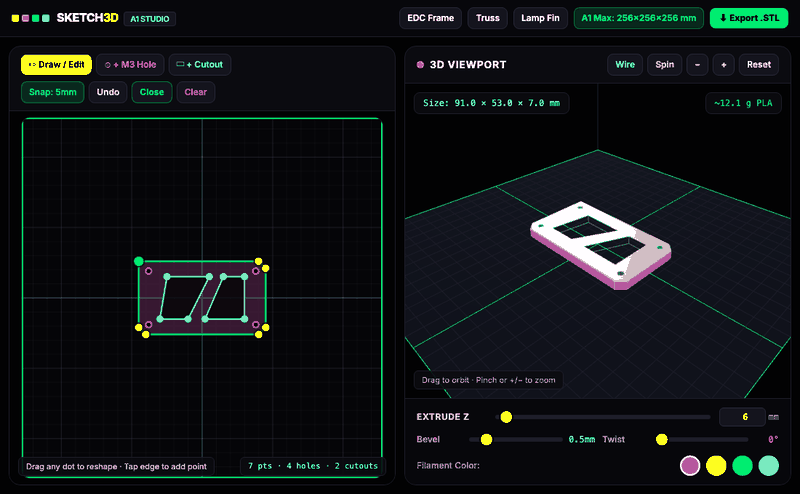
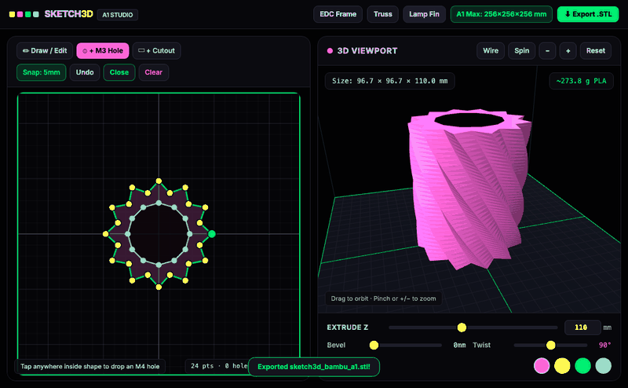

# SKETCH3D — Parametric 3D Sketcher for Bambu Lab A1

> **Touch-first, zero-install parametric CAD in your browser.** Sketch 2D profiles on iPad with Apple Pencil, apply real-time Grasshopper-style modifiers, and export slicer-ready binary `.stl` files directly for your **Bambu Lab A1**.

[](https://iocfinc.github.io/sketch3d/)
[-00E56D)](https://bambulab.com/en/a1/tech-specs)
[](#)
[](#)
[](#)
[](LICENSE)

---

## 🎬 Visual Walkthrough & Workflows

### 1. 2D Sketching to Parametric Extrusion & Binary STL Export
Draw custom closed profiles with 5mm grid snapping, insert concentric M3/M4 mounting holes, adjust extrusion height with live PLA filament estimation, and export directly to `.stl`:



### 2. Parametric Modifiers (Bevel, Twist, Wireframe & Filament Colors)
Modify complex shapes in real-time with Grasshopper-style procedural Bevel (`0–4 mm`) and Twist (`0–180°`) deformers, preview filament colors, and inspect wireframe geometry:



---

## ✨ Key Features

* **Touch & Pencil Native:** Engineered for iPad Safari (Apple Pencil and multi-touch gestures) with 20px hit targets, draggable vertices, edge-point splitting, and dedicated Split / 2D / 3D responsive views.
* **Bambu Lab A1 Print Volume Constraints:** Hard-clamped build envelope ($256 \times 256 \times 256\text{ mm}$), live bounding box dimensions, and PLA filament weight estimation ($\approx 35\%$ effective print density).
* **Watertight Slicer Alignment:** Real-time Three.js Y-up to 3D printer Z-up coordinate transformation (`(X, -Z, Y)`), ensuring models land flat on the textured PEI plate in Bambu Studio and OrcaSlicer.
* **Parametric Modifiers:** Real-time vertex twist deformation around the build axis and multi-segment beveling.
* **100% Client-Side ($0 Hosting):** Zero server backend, zero API latency, and complete privacy—runs entirely within client WebGL and Web Workers.

---

## 🚀 Quickstart

Run locally with any standard static web server:

```bash
# Clone the repository
git clone https://github.com/iocfinc/sketch3d.git
cd sketch3d

# Start local preview
python3 -m http.server 8088
# Visit http://localhost:8088 in your browser
```

---

## 📐 Architecture & Roadmap

Comprehensive engineering specifications are provided in the repository:
* [`HANDOVER_SPEC.md`](./HANDOVER_SPEC.md) — Original project requirements and Bambu A1 constraints.
* [`BUILD_ROADMAP.md`](./BUILD_ROADMAP.md) — 8-week Master Build Roadmap covering Phases 1 to 3 with 10-epic ticket breakdown.
* [`KERNEL_ARCHITECTURE_SPEC.md`](./KERNEL_ARCHITECTURE_SPEC.md) — Web Worker `manifold-3d` WASM CSG, `verb-nurbs` lofting, and 3MF AMS Lite multi-color packaging.
* [`UX_ARCHITECTURE_SPEC.md`](./UX_ARCHITECTURE_SPEC.md) — Multi-layer Z-stacking, Apple Pencil tilt/pressure interaction, and project JSON schemas.
* [`SLICER_GUARDRAILS_SPEC.md`](./SLICER_GUARDRAILS_SPEC.md) — Sub-0.8mm wall thickness alerts, $45^\circ$ overhang GLSL shaders, and Bambu PEI shrinkage compensation.

---

## 🏷️ Search Topics & Tags

`3d-printing` · `bambu-lab` · `bambu-a1` · `threejs` · `parametric-cad` · `rhino-grasshopper` · `ipad-cad` · `apple-pencil` · `stl-export` · `webgl` · `manifold-3d` · `3mf-export`

---

## 📄 License

MIT License.
